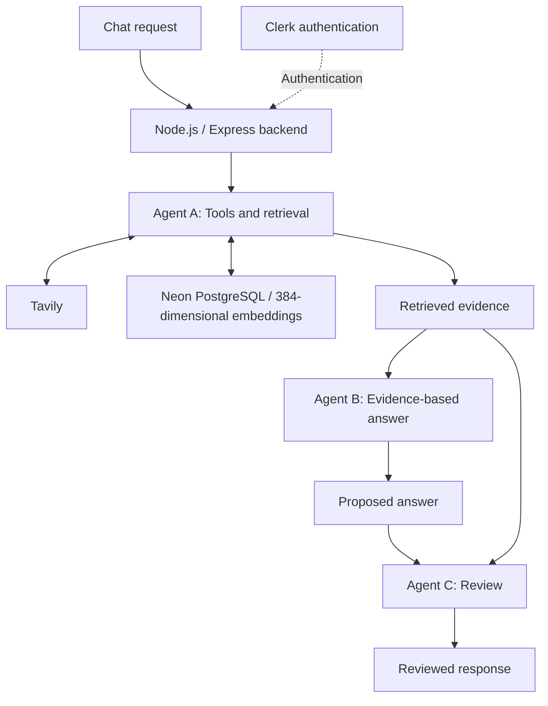

# Evidence-Grounded Multi-Agent Chat System

A chat system that separates evidence retrieval, answer generation, and review into three dedicated agents. Built with Node.js and Express, it combines Tavily retrieval, Clerk authentication, and Neon PostgreSQL with 384-dimensional embeddings.

The project explores a practical question: **how can a conversational system make its answers easier to assess against supporting evidence?** Its architecture gives retrieval and review explicit roles, rather than treating answer generation as a single step.

## Overview

The system organizes the response workflow around three responsibilities:

| Agent | Role | Responsibility |
| --- | --- | --- |
| **A** | Tools and retrieval | Gather evidence through tools and retrieval. |
| **B** | Evidence-based answering | Generate an answer using the retrieved evidence. |
| **C** | Review | Review the proposed answer against the available evidence. |

This separation makes each stage easier to reason about and creates a clear place to examine whether an answer is supported by its sources.

## Architecture



*The diagram summarizes the logical workflow; it does not specify API routes, database tables, or deployment topology.*

### Response workflow

1. **Retrieve:** Agent A gathers evidence relevant to the user's question.
2. **Answer:** Agent B uses that evidence to compose a response.
3. **Review:** Agent C evaluates the proposed response against the evidence.

The review stage provides an additional opportunity to identify unsupported claims. It does not guarantee that every answer is correct or that the retrieved evidence is complete.

## Technology Stack

| Component | Technology | Purpose |
| --- | --- | --- |
| Backend | Node.js, Express | Handle requests and coordinate the agent workflow. |
| Model API | Groq SDK | Connect the agent workflow to language models. |
| Retrieval | Tavily | Retrieve external information for evidence gathering. |
| Authentication | Clerk | Provide user authentication. |
| Database | Neon PostgreSQL | Provide the system's database layer. |
| Vector representation | 384-dimensional embeddings | Represent content for embedding-based retrieval. |

## Chat History and Retrieval

For authenticated users, the backend stores the user message and the three agent replies in `messages`. It links the user-message embedding in `knowledge_chunks` to that message through `message_id`.

History search filters records by the authenticated user's ID and retrieves up to five matches ordered by vector distance. It returns `agent_c` as `assistant_reply`, so the evidence passed to the answering agent contains the final reply shown to the user, together with the record ID and original user message. Internal Agent A and B replies remain stored but are not presented as the historical assistant reply.

Semantic history search ranks by relevance, not recency. The separate `/history` endpoint returns up to 50 messages for the current user, ordered newest first.

## Design Rationale

- **Separate responsibilities:** Retrieval, writing, and review have distinct roles, making the workflow easier to inspect and refine.
- **Ground answers in evidence:** Retrieved information provides the basis for answer generation and review.
- **Make review explicit:** A dedicated review agent adds a separate checkpoint before the response is returned.

## Getting Started

### Prerequisites

- Node.js and npm. Local verification used Node.js `22.20.0` on Windows; `package.json` does not declare a minimum version.
- A Neon PostgreSQL database.
- Groq and Tavily API credentials.
- A Clerk application with publishable and secret keys.

### 1. Install dependencies

Open a terminal in the backend directory containing both `server.js` and `package.json`. Run all commands below from that directory:

```sh
npm install
```

### 2. Configure environment variables

Create a `.env` file in the backend directory by copying `.env.example`.

For PowerShell:

```powershell
Copy-Item .env.example .env
```

For macOS or Linux:

```sh
cp .env.example .env
```

If your downloaded example is named `env.example` without a leading dot, use that filename as the source instead. Fill in the credentials in `.env`:

```dotenv
DATABASE_URL=<your-neon-postgresql-connection-string>
GROQ_API_KEY=<your-groq-api-key>
TAVILY_API_KEY=<your-tavily-api-key>
CLERK_PUBLISHABLE_KEY=<your-clerk-publishable-key>
CLERK_SECRET_KEY=<your-clerk-secret-key>
PORT=3000
CHAT_RATE_LIMIT=10
CHAT_RATE_WINDOW_MS=60000
```

| Variable | Configuration |
| --- | --- |
| `DATABASE_URL` | Connection string for the Neon PostgreSQL database. |
| `GROQ_API_KEY` | API key for Groq. |
| `TAVILY_API_KEY` | API key for Tavily retrieval. |
| `CLERK_PUBLISHABLE_KEY` | Publishable key for the Clerk application. |
| `CLERK_SECRET_KEY` | Secret key for the Clerk application. |
| `PORT` | Port setting; the example uses `3000`. |
| `CHAT_RATE_LIMIT` | Chat rate limit setting; the example uses `10`. |
| `CHAT_RATE_WINDOW_MS` | Rate limit window setting in milliseconds; the example uses `60000` (one minute). |

Keep `.env` out of version control and add it to `.gitignore`. Commit only the example file with empty credentials or placeholders. The precise rate limit behavior depends on the server implementation.

### 3. Initialize the database

Open the Neon SQL Editor for the database specified by `DATABASE_URL` and run the following SQL to initialize a fresh database. It enables `pgvector` and creates tables for chat messages and knowledge chunks, including fields for all three agents.

```sql
CREATE EXTENSION IF NOT EXISTS vector;

CREATE TABLE IF NOT EXISTS messages (
  id INTEGER GENERATED ALWAYS AS IDENTITY PRIMARY KEY,
  user_message TEXT NOT NULL,
  agent_a TEXT NOT NULL,
  agent_b TEXT NOT NULL,
  agent_c TEXT,
  user_id TEXT,
  created_at TIMESTAMPTZ DEFAULT NOW()
);

CREATE TABLE IF NOT EXISTS knowledge_chunks (
  id INTEGER GENERATED ALWAYS AS IDENTITY PRIMARY KEY,
  message_id INTEGER REFERENCES messages(id),
  user_message TEXT,
  agent_a_message TEXT,
  agent_b_message TEXT,
  agent_c_message TEXT,
  user_embedding vector(384),
  agent_a_embedding vector(384),
  agent_b_embedding vector(384),
  agent_c_embedding vector(384),
  metadata JSONB DEFAULT '{}'::jsonb,
  created_at TIMESTAMPTZ DEFAULT NOW()
);
```

Each embedding column stores a 384-dimensional vector. The current save path writes `message_id` and `user_embedding` to `knowledge_chunks`; the message text and agent replies are stored in `messages`. The additional text and agent embedding columns are retained for compatibility and are not populated by this save path.

Use this schema for a fresh installation; `CREATE TABLE IF NOT EXISTS` does not update tables that already exist.

If you used the earlier schema without Agent C fields, `user_id`, or `message_id`, apply the following updates. Making `knowledge_chunks.user_message` nullable allows the current save path to store text in `messages` without duplicating it:

```sql
BEGIN;

ALTER TABLE messages
  ADD COLUMN IF NOT EXISTS agent_c TEXT,
  ADD COLUMN IF NOT EXISTS user_id TEXT;

ALTER TABLE knowledge_chunks
  ADD COLUMN IF NOT EXISTS agent_c_message TEXT,
  ADD COLUMN IF NOT EXISTS agent_c_embedding vector(384),
  ADD COLUMN IF NOT EXISTS message_id INTEGER REFERENCES messages(id);

ALTER TABLE knowledge_chunks
  ALTER COLUMN user_message DROP NOT NULL;

COMMIT;
```

These updates preserve existing rows. They do not backfill user IDs or message links for older records; such records may not appear in user-scoped history search.

### 4. Start the development server

From the backend directory containing `server.js`, run:

```sh
node --watch server.js
```

This is the project's current local development command. Watch mode restarts the process when watched files change. Keep the terminal open while developing; press `Ctrl+C` to stop the server.

The current `package.json` does not define `start` or `dev` scripts, so use the command above directly.

With `PORT=3000`, open [http://localhost:3000](http://localhost:3000) and sign in through Clerk to use the chat interface. Confirm that the terminal reports a successful database connection before testing a conversation.

### 5. Run tests

The package defines the following test command, which invokes Node.js's built-in test runner:

```sh
npm test
```

The recorded local test run passed all 13 tests. The reported cases cover agent response validation, review decision validation, history-request preflight checks, and bounded retries. This does not establish full end-to-end coverage of external services.

Manual verification also confirmed message persistence, a linked 384-dimensional user embedding, and accurate quotation of a stored final assistant reply in a targeted history lookup.

## Troubleshooting

### Windows: `sharp` fails to load when saving history

If an answer appears but history saving fails with:

```text
Could not load the "sharp" module using the win32-x64 runtime
```

Stop the server with `Ctrl+C`, then run this command in the backend directory to include optional dependencies:

```sh
npm install --include=optional
```

Restart the server:

```sh
node --watch server.js
```

Send a new test message and check whether it saves successfully. If the error persists, consult the [sharp installation documentation](https://sharp.pixelplumbing.com/install/). Install dependencies on the target computer rather than copying `node_modules` from another machine.

### `Cannot find module ... server.js`

The command must run from the directory containing `server.js`. Check the terminal's current directory and move into the backend folder before starting the server.

### `column "message_id" of relation "knowledge_chunks" does not exist`

The database uses an older schema. Apply the database updates in Getting Started to the database referenced by `DATABASE_URL`. The current save path requires `messages.user_id`, `knowledge_chunks.message_id`, and a nullable `knowledge_chunks.user_message`.

### History evidence contains `undefined`

Keep the history query and evidence formatter in sync. The query returns `m.agent_c AS assistant_reply`; the formatter must read `item.assistant_reply`. Reading `item.agent_a`, `item.agent_b`, or `item.agent_c` from that query result produces missing values.

### The page displays `Failed to fetch`

Check the backend terminal for startup or request errors. Wait for a successful restart after saving files in watch mode, then retry. The browser message alone does not identify the cause.

## Limitations and Evaluation

Answer quality depends on retrieval relevance, source quality, and the behavior of the answering and review agents. A separate reviewer may still miss errors or accept weak evidence.

No benchmark results are reported in this README. Useful future evaluation dimensions include evidence relevance, claim support, review effectiveness, response latency, and cost per request.
